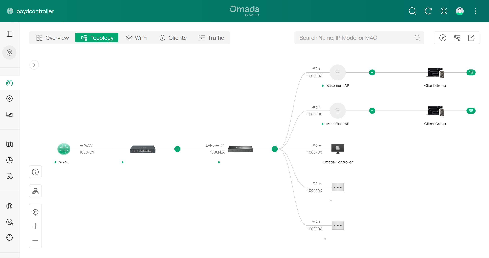

# Home Network Segmentation — TP-Link Omada Lab

A self-directed home lab in which I took my flat home network and rebuilt it into a
segmented design: three isolated VLANs (Main, IoT, Guest), per-VLAN Wi-Fi networks, and a
gateway ACL trust model — all managed from a TP-Link Omada Software Controller and documented
with the reasoning behind each decision.

> **This is a self-directed learning project on my own home network, not production
> experience.** I built it to get hands-on with the networking fundamentals (VLANs, routing,
> ACLs, stateful firewalling) that sit underneath IT support / MSP work.

---

## Why this lab exists

Most home networks — and plenty of small-business ones — are a single flat `/24` where a $10
smart plug sits in the same broadcast domain as the laptop used for banking. That's exactly the
kind of setup an MSP walks into and has to fix.

I wanted to do that fix myself, end to end, on real hardware: design the subnets, map wireless
networks onto them, write the firewall rules, and then deal with the side effects (like device
discovery breaking across VLANs). The goal was a network that's actually more secure *and* still
pleasant to live with — with the trade-offs written down, not just the clicks.

---

## Environment / architecture

| Component | Detail |
|---|---|
| Management | TP-Link Omada Software Controller (v6.2.x), self-hosted on Windows |
| Gateway | 1 × TP-Link Omada ER605 — routes between VLANs, enforces ACLs, serves DHCP |
| Switching | 1 × TP-Link TL-SG2008P — 8-port Gigabit smart managed switch (4 × PoE+), trunks tagged VLANs to the APs and powers them over PoE+ |
| Wireless | 2 × TP-Link Omada EAP650 — Wi-Fi 6 (AX3000) ceiling APs (Basement, Main Floor), PoE+ powered from the switch, one SSID per VLAN, seamless roaming |
| VLANs | Main (1), IoT (20), Guest (30) |
| Starting point | Flat `192.168.0.0/24`, everything in one broadcast domain |

**Logical layout**

```
Internet
   │
ER605 Gateway ── routes between VLANs · Gateway ACLs · DHCP per VLAN
   │
TL-SG2008P Switch ── 802.1Q trunk (VLANs 1, 20, 30 tagged)
   │
   ├── EAP650 (Basement)   ─┐
   ├── EAP650 (Main Floor) ─┴── RedLeader       → VLAN 1   192.168.0.0/24   (trusted)
   │                            RedLeader_IoT   → VLAN 20  192.168.20.0/24  (contained)
   │                            RedLeader_Guest → VLAN 30  192.168.30.0/24  (contained, client isolation)
   └── Omada Controller host
```

**Live topology from the Omada Controller**



*All links at 1 Gbps full duplex. The two EAP650s are serving 13 and 35 wireless clients
across the three SSIDs. Device MAC addresses and personal device names removed.*

### Trust matrix (end result)

| From ↓ / To → | Main | IoT | Guest | Internet |
|---|:-:|:-:|:-:|:-:|
| **Main** | ✔ | ✔ | ✔ | ✔ |
| **IoT** | ✘ | ✔ | ✘ | ✔ |
| **Guest** | ✘ | ✘ | ✔ | ✔ |

Main can reach into the other networks; IoT and Guest can only reach the internet and
themselves. Four deny rules plus a stateful firewall produce this — see
[Phase 3](docs/03-gateway-acls.md) for why no "allow" rules were needed.

Validated with baseline-and-blocked tests in [Phase 5](docs/05-validation.md) — which also
surfaced a real gap: IoT devices could load the gateway's admin login page, because
inter-VLAN rules don't cover traffic addressed *to* the gateway itself. **Found, explained,
fixed with a fifth rule, and re-tested.**

---

## Skills demonstrated

- **VLAN design** — splitting one broadcast domain into purpose-based subnets with 802.1Q tagging
- **IP addressing & DHCP** — per-VLAN scopes, with a reserved range kept free for static assignments
- **Wireless configuration** — binding SSIDs to VLANs, band selection trade-offs, guest client isolation
- **Trunking** — tagged vs. untagged traffic; APs carrying multiple VLANs over a single uplink
- **Firewall / ACL logic** — top-down first-match evaluation, implicit allow (Omada) vs. implicit deny (Cisco)
- **Stateful firewalling** — using return-traffic behaviour to build one-way trust with deny rules only
- **Service discovery** — mDNS/Bonjour vs. SSDP/DIAL, and why multicast discovery doesn't cross VLANs
- **Design trade-offs** — weighing security gain against day-to-day usability (the Roku decision)

---

## Build log (by phase)

Each phase links to a detailed write-up with the reasoning, the exact settings, and
verification steps.

| Phase | What was built | Doc |
|---|---|---|
| 1 | VLAN & subnet design — Main, IoT, Guest | [01-vlan-design.md](docs/01-vlan-design.md) |
| 2 | Wireless — SSID-to-VLAN mapping across both APs | [02-wireless-ssids.md](docs/02-wireless-ssids.md) |
| 3 | Gateway ACL trust model | [03-gateway-acls.md](docs/03-gateway-acls.md) |
| 4 | mDNS discovery across VLANs & the Roku placement decision | [04-mdns-and-discovery.md](docs/04-mdns-and-discovery.md) |
| 5 | Validation — proving the isolation actually works | [05-validation.md](docs/05-validation.md) |

---

## Key design decisions

- **Segment the noisy, low-trust devices; keep actively-controlled devices trusted.** Bulbs,
  plugs and sensors go on IoT. A streaming box that's driven from a phone all day stays on Main.
- **Deny-only ACLs.** Omada's gateway ACL ends in an implicit *allow*, and the firewall is
  stateful — so four deny rules are enough to get one-way trust from Main into IoT/Guest.
- **Both bands on IoT.** IoT SSIDs are often 2.4 GHz-only, but the TV streams over Wi-Fi and
  needs 5 GHz throughput.

---

## What I'd build next
- **Switch ACLs / port-level VLAN assignment** for wired IoT devices
- **A dedicated Lab VLAN** for the [Active Directory home lab](https://github.com/mattwboyd/active-directory-homelab)
  so domain traffic is isolated from the household network
- **DNS filtering** (e.g. Pi-hole or gateway DNS filtering) per VLAN
- **A management VLAN** for the controller, switch and APs
- **A NAS / storage project** — planned as a separate build

---

*Built and documented by Matthew as part of an IT support / MSP career transition.*
