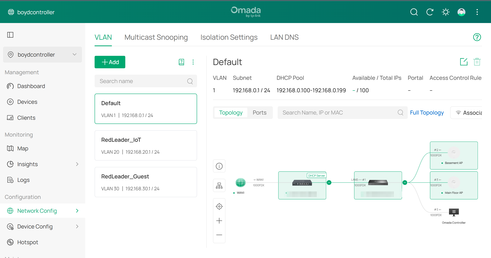

# Phase 1 — VLAN & Subnet Design

**Goal:** Turn a flat `192.168.0.0/24` network into three separate broadcast domains so that
low-trust devices (IoT, guests) are contained to their own subnets.

---

## Key concepts

- **Flat network problem** — on a single `/24`, every device can see and talk to every other
  device. A compromised smart plug has the same network reach as a laptop.
- **VLANs** — 802.1Q tagging lets one set of physical hardware carry several isolated Layer 2
  networks. Each VLAN gets its own subnet, and traffic between them has to go *through the
  gateway*, which is where policy can be enforced.
- **Design principle** — segment the noisy, low-trust devices; keep actively-controlled
  devices on the trusted network.

---

## Design

| Purpose | VLAN ID | Subnet | Gateway | DHCP Pool | Omada Network Name |
|---|---|---|---|---|---|
| Main (trusted) | 1 | 192.168.0.0/24 | 192.168.0.1 | .100–.199 | Default |
| IoT | 20 | 192.168.20.0/24 | 192.168.20.1 | .100–.199 | RedLeader_IoT |
| Guest | 30 | 192.168.30.0/24 | 192.168.30.1 | .100–.199 | RedLeader_Guest |

**Why these numbers:** the third octet matches the VLAN ID (`20` → `192.168.20.x`), so any IP
address tells you at a glance which network a device is on.

**Why the pool starts at `.100`:** it leaves `.1–.99` free for the gateway and any static or
reserved assignments, so DHCP never hands out an address that collides with one.

---

## Build

Each VLAN was created in the Omada Controller under:

```
Network Config → VLAN → Add LAN
    Purpose:  Interface        (so the gateway routes for it)
    VLAN ID:  20 / 30
    Gateway/Subnet: 192.168.20.1/24 / 192.168.30.1/24
    DHCP Server: Enabled, range .100–.199
    DNS / Default Gateway: Auto
```

The *Interface* purpose matters — it makes the gateway an actual Layer 3 interface on that
VLAN, which is what lets it hand out DHCP, route the traffic, and later apply ACLs to it.



*All three networks in the controller, with the Default VLAN's `.100–.199` DHCP pool. The
topology on the right shows the physical path every VLAN shares: WAN → gateway (DHCP server)
→ switch → Basement AP, Main Floor AP and the Omada Controller host. Device MAC addresses
are blurred.*

---

**Next:** [Phase 2 — Wireless (SSID → VLAN mapping)](02-wireless-ssids.md)
