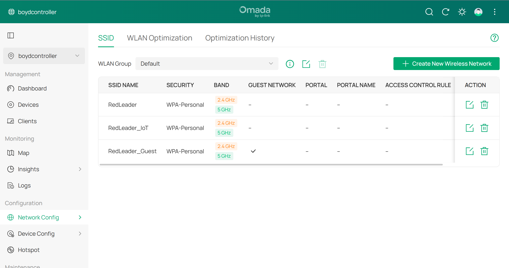
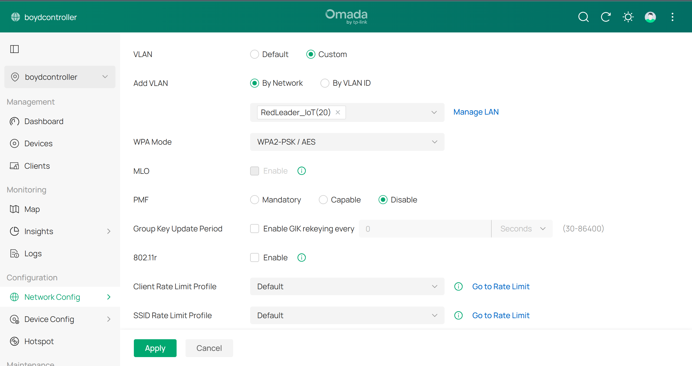

# Phase 2 — Wireless (SSID → VLAN Mapping)

**Goal:** Give each VLAN its own Wi-Fi network so devices land on the right subnet just by
choosing which SSID to join.

---

## Key concepts

- **SSID-to-VLAN binding** — each SSID tags its clients' traffic with a VLAN ID, so the
  wireless network you join decides your subnet.
- **Trunk vs. access, tagged vs. untagged** — the APs' uplink is a trunk carrying all three
  VLANs as tagged traffic; the switch and gateway sort it back out by tag.
- **Guest isolation** — on top of VLAN separation, the Guest SSID stops guest devices from
  talking to *each other*.

---

## Build

Three SSIDs, each bound to its VLAN via:

```
Wireless Networks → (SSID) → Advanced Settings → VLAN → Custom → By Network
```

Binding **by network** (instead of typing a raw VLAN ID) links the SSID directly to the LAN
object from Phase 1, so subnet and DHCP stay consistent automatically if anything changes.

| SSID | VLAN | Bands | Notes |
|---|---|---|---|
| RedLeader | 1 (Main) | 2.4 + 5 GHz | Existing trusted network |
| RedLeader_IoT | 20 | 2.4 + 5 GHz | Both bands kept — TV streams video over Wi-Fi and needs 5 GHz |
| RedLeader_Guest | 30 | 2.4 + 5 GHz | Guest Network toggle **ON** (wireless client isolation) |

The APs carry all three VLANs as tagged traffic over the trunk automatically — **no per-AP
configuration was needed**. Each SSID is pushed to both APs with seamless roaming.



*All three SSIDs broadcasting on both bands with WPA-Personal. Only `RedLeader_Guest` has
Guest Network enabled, which turns on client isolation for that SSID.*



*The IoT SSID's VLAN binding: **Custom → By Network → RedLeader_IoT (20)**. Selecting the
network object instead of typing `20` means the SSID follows the LAN definition from Phase 1.*

---

## Design note — bands on the IoT SSID

IoT SSIDs are commonly set to **2.4 GHz only**, because older smart-home devices are
2.4-only and some fail to onboard when the SSID is shared with 5 GHz. This build kept **both
bands** because the TV on that network streams video and needs 5 GHz throughput. If a device
ever refuses to join, a separate 2.4 GHz-only IoT SSID on the same VLAN is the fallback.

---

**Previous:** [Phase 1 — VLAN design](01-vlan-design.md) · **Next:** [Phase 3 — Gateway ACLs](03-gateway-acls.md)
