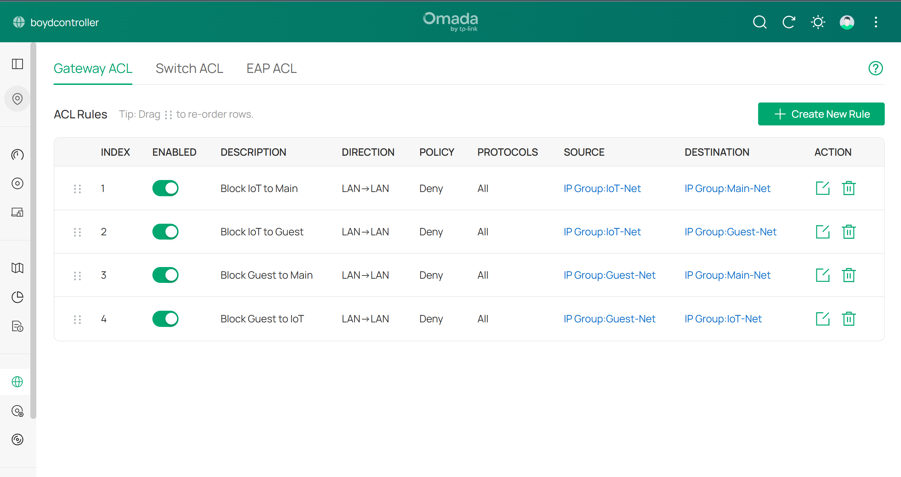

# Phase 3 — Gateway ACL Trust Model

**Goal:** Stop IoT and Guest devices from reaching the trusted network (and each other), while
letting trusted devices reach everything.

---

## Key concepts

- **Why a *Gateway* ACL** — traffic between VLANs is *routed* by the gateway, so the gateway
  is the place to filter it. (Switch ACLs act on traffic the switch forwards itself.)
- **Evaluation order** — Omada Gateway ACLs are evaluated **top-down, first match wins**,
  with an **implicit ALLOW-all** at the bottom. Each rule carves out a *deny* exception;
  anything not denied is permitted.
- **Contrast with Cisco** — Cisco ACLs end in an implicit **deny**, so you'd write the allows
  instead. Knowing which default you're working against changes how you write every rule.
- **Stateful firewall** — return traffic for a connection that was allowed in one direction
  is automatically allowed back.

---

## Build

Rules created under **Network Security → Gateway ACL**.

Source and destination are **IP Groups** (named subnets) created under **Profiles → Groups**,
because this firmware references IP Groups rather than VLAN objects directly in ACLs.

All rules: **Direction:** LAN→LAN · **Policy:** Deny · **Protocol:** All

| # | Description | Source | Destination |
|---|---|---|---|
| 1 | Block IoT to Main | IoT-Net (192.168.20.0/24) | Main-Net (192.168.0.0/24) |
| 2 | Block IoT to Guest | IoT-Net | Guest-Net (192.168.30.0/24) |
| 3 | Block Guest to Main | Guest-Net | Main-Net |
| 4 | Block Guest to IoT | Guest-Net | IoT-Net |
| 5 | Block IoT to Gateway Management | IoT-Net | Gateway Management Page — **TCP only** |

> **Rule 5 was added after validation.** Rules 1–4 block traffic routed *between* VLANs, but
> testing showed IoT could still reach the gateway's own admin page. Rule 5 is the exception to
> "Protocol: All": with all protocols it also blocked DNS and ping to the gateway and broke a
> real IoT device, so it's scoped to TCP. See the
> [Phase 5 finding](05-validation.md#finding--iot-could-reach-the-gateway-itself-fixed).

*The original four rules live in the controller: all enabled, LAN→LAN, Deny, all protocols, using IP
Group sources and destinations. Order is shown by the index column; rows can be dragged to
re-order, which would matter if an allow rule were ever added.*

---

## Resulting trust matrix

| From ↓ / To → | Main | IoT | Guest | Internet |
|---|:-:|:-:|:-:|:-:|
| **Main** | ✔ | ✔ | ✔ | ✔ |
| **IoT** | ✘ | ✔ | ✘ | ✔ |
| **Guest** | ✘ | ✘ | ✔ | ✔ |

### Why no "allow Main → IoT" rule is needed

The implicit allow-all already permits Main → IoT. Because the firewall is **stateful**, when
a Main device (e.g. a phone) starts a connection to an IoT device, the replies for that
session are let back in — even though Rule 1 blocks IoT-*initiated* traffic to Main.

The result is **one-way trust**: Main can reach into IoT, IoT can't reach back.

### Why rule order doesn't matter here

All the rules are denies with non-overlapping source/destination pairs, so none of them can
shadow another. If an allow rule were ever added (say, IoT → a printer on Main), it would
have to sit *above* Rule 1 to take effect.

---

**Previous:** [Phase 2 — Wireless](02-wireless-ssids.md) · **Next:** [Phase 4 — mDNS & discovery](04-mdns-and-discovery.md)
