# Phase 5 — Validation

**Goal:** Prove the segmentation actually works, not just that the settings were entered.
Testing the *blocked* paths matters as much as testing the allowed ones — and every "blocked"
result needs a baseline showing the target *does* answer when it should.

---

## Results

| Check | Test | Result |
|---|---|---|
| Clients on the right subnets | Omada **Clients** page | ✅ Main → `192.168.0.x`, IoT → `192.168.20.x`, Guest → `192.168.30.x` |
| Roku placement | Clients page | ✅ `55TCLRokuTV-Office` on `192.168.0.126` / `RedLeader` (Main) |
| Guest → Internet | `ping 8.8.8.8` from `RedLeader_Guest` | ✅ 0% loss |
| Guest → Main / IoT | `ping 192.168.0.1` and `192.168.20.1` from `RedLeader_Guest` | ✅ 100% loss — blocked |
| Main → Roku (baseline) | `ping 192.168.0.126` from `RedLeader` | ✅ 0% loss — target answers pings |
| IoT → Internet | `ping 8.8.8.8` from `RedLeader_IoT` | ✅ 0% loss |
| IoT → Main device | `ping 192.168.0.126` from `RedLeader_IoT` | ✅ 100% loss — blocked |
| IoT → gateway's other interfaces | `ping 192.168.0.1` and `192.168.30.1` from `RedLeader_IoT` | ⚠️ **Replies** — see [finding](#finding--iot-could-reach-the-gateway-itself-fixed) |
| IoT → gateway management page | Browse `https://192.168.0.1` from `RedLeader_IoT` | ⚠️ Login page loaded → 🔧 Rule 5 → ✅ times out on `.0.1` and `.20.1` |
| IoT → gateway DNS and ping (regression check) | `nslookup google.com` and `ping 192.168.20.1` from `RedLeader_IoT` | ⚠️ First version of Rule 5 broke both → 🔧 narrowed to TCP → ✅ both work |
| Real IoT device (Bambu Lab printer) | Printer cloud connection | ⚠️ Disconnected under first Rule 5 → ✅ connected with final rule |

---

## Evidence

### Clients landed on the right subnets

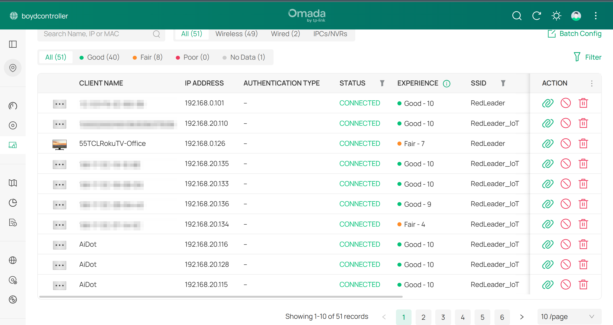

*Main and IoT side by side. Each SSID hands out addresses from its own VLAN: `RedLeader` →
`192.168.0.x`, `RedLeader_IoT` → `192.168.20.x`. Note `55TCLRokuTV-Office` on
`192.168.0.126` / `RedLeader` — the Roku sitting on Main, per the
[Phase 4 decision](04-mdns-and-discovery.md). MAC-address client names are blurred.*

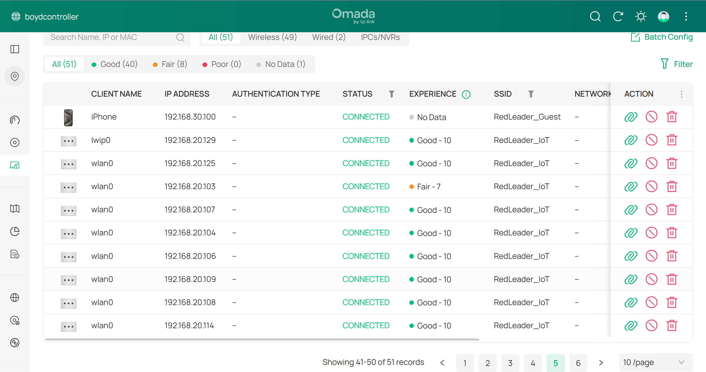

*A guest device (`iPhone`) on `RedLeader_Guest` received `192.168.30.100` — the first address
in the Guest pool — while the smart-home devices stay on `192.168.20.x`.*

### Guest isolation

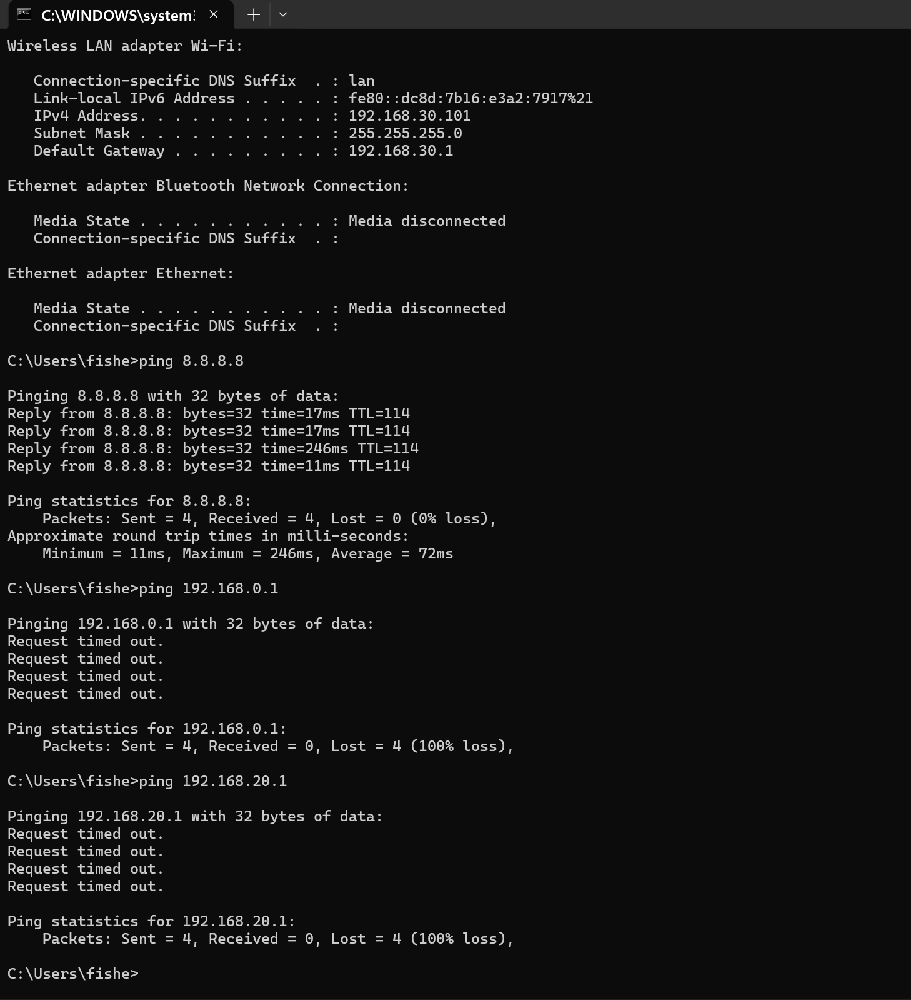

*A laptop on `RedLeader_Guest` gets `192.168.30.101` (gateway `192.168.30.1`), reaches the
internet (`8.8.8.8`, 0% loss), but gets **100% loss** to both Main (`192.168.0.1`) and IoT
(`192.168.20.1`).*

### IoT isolation — with a baseline

A timeout on its own proves nothing: some devices simply ignore ping. So the same target was
tested from both sides.

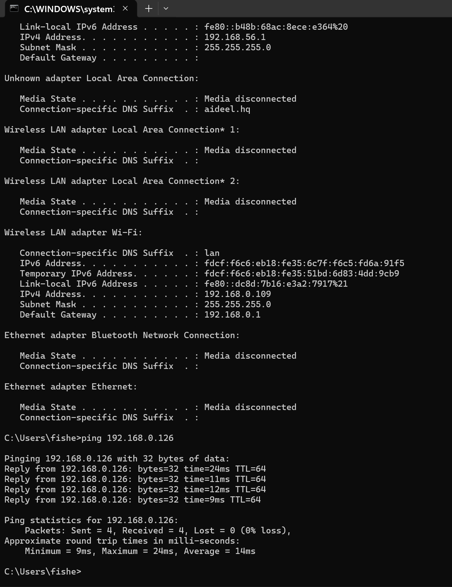

*Baseline — from Main (`192.168.0.109`), the Roku at `192.168.0.126` replies. It answers
pings.*

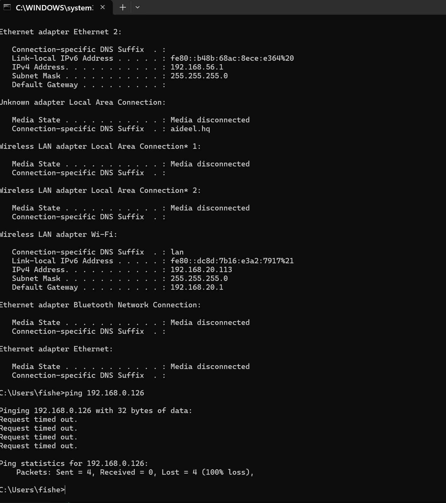

*Same laptop, same target, now on `RedLeader_IoT` (`192.168.20.113`): **100% loss**. The only
thing that changed is the VLAN, so the block is Rule 1 (Block IoT to Main) doing its job.*

---

## Finding — IoT could reach the gateway itself (fixed)

### What was found

While testing from IoT, pings to `192.168.0.1` and `192.168.30.1` — the gateway's addresses
on Main and Guest — **replied**, even though pings to a real Main device were blocked.

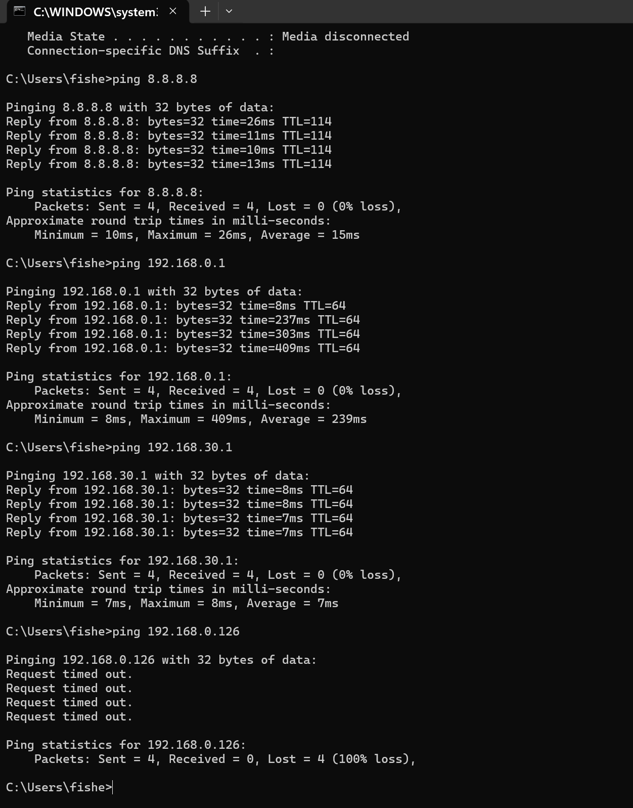

*From IoT: the gateway answers on its Main and Guest addresses, but the Roku behind it does
not. Note the replies come back with **TTL=64** — the starting value — meaning no router hop
decremented it. The gateway answered directly; nothing crossed into another VLAN.*

Following that lead, browsing to the gateway from IoT loaded its **admin login page**:

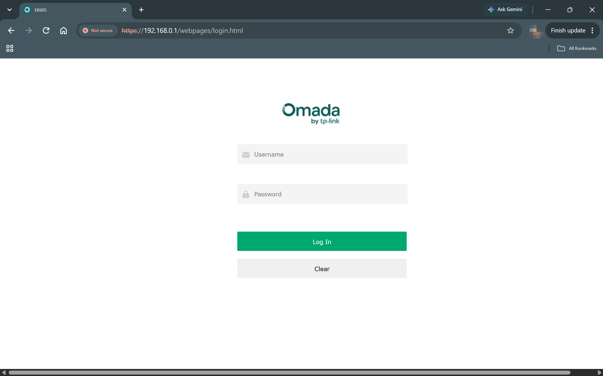

*Before the fix — the ER605's management login, reachable from the IoT network.*

### Why it happened

`192.168.0.1`, `.20.1` and `.30.1` are all interfaces on the *same device* — the gateway.
The Gateway ACLs are **LAN→LAN** rules, which filter traffic the gateway *routes between*
subnets. A request to one of the gateway's own addresses isn't routed anywhere; it's traffic
*to* the gateway, so those rules never see it — even though `192.168.0.1` sits inside the
`Main-Net` IP Group.

**Why Guest didn't show the same thing:** `RedLeader_Guest` has Omada's **Guest Network**
option enabled, which blocks guests from reaching private addresses — gateway included. IoT
doesn't have that option, so it only had the LAN→LAN rules.

**Risk:** host-to-host isolation was intact — IoT couldn't reach any device on Main or Guest.
The exposure was the gateway itself: a compromised IoT device could reach the login page of
the box that runs the whole network and attempt to brute-force it.

### Fix options considered

| Option | Effect | Decision |
|---|---|---|
| Enable **Guest Network** on `RedLeader_IoT` | Blocks all private addresses — but also turns on client isolation (IoT devices can't talk to each other), may break local control from Main, and only covers Wi-Fi | Rejected — too broad |
| Gateway ACL with destination **Gateway Management Page** | Targets traffic addressed to the gateway itself | **Chosen** — but see below; it took three attempts to get right |

### Attempt 1 — "Gateway Management Page", all protocols

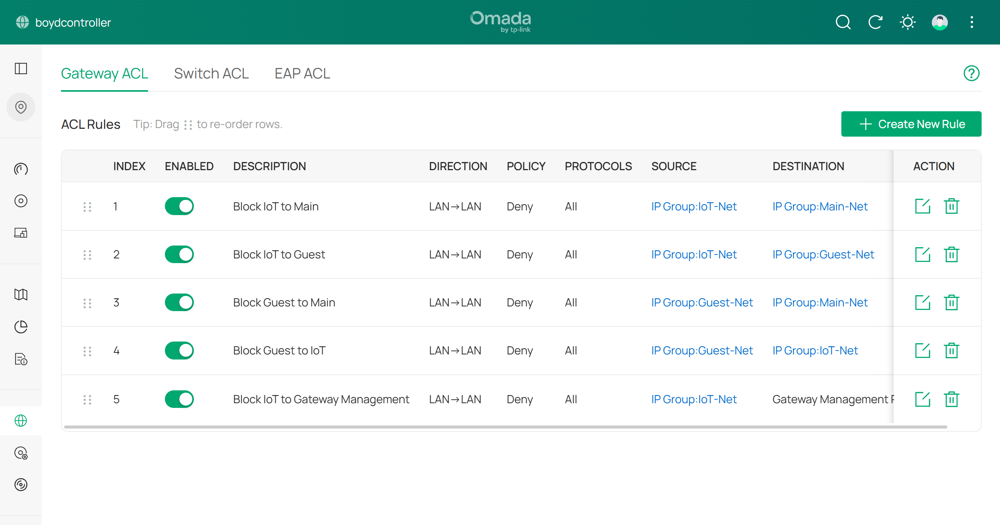

*First version of Rule 5: LAN→LAN, Deny, **All** protocols, `IoT-Net` → Gateway Management
Page.*

The admin page timed out from IoT, so this looked like a fix. **It wasn't a clean one.** A few
days later the **Bambu Lab 3D printer** on the IoT network dropped its connection; disabling
Rule 5 brought it straight back.

**Diagnosis**, from a laptop on IoT with Rule 5 enabled:

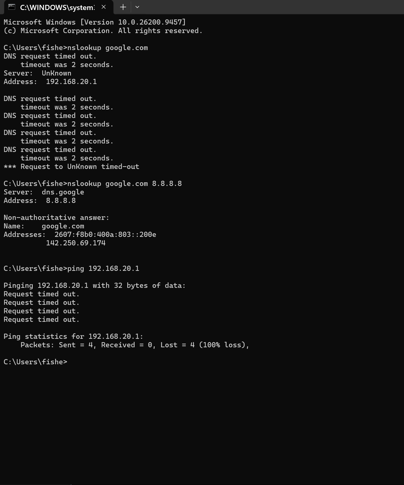

*DNS through the gateway (`192.168.20.1`) **times out**; the same lookup sent straight to
`8.8.8.8` **works**; ping to the gateway **fails**. The rule was blocking DNS and ICMP to the
gateway — not just the admin page.*

Omada's own help text for this destination explains why: *"This option will block **all
packets** sent from the specified source to the gateway's WAN and LAN interface IP."* With
**Protocols: All**, that meant DNS (the gateway is IoT's DNS server, handed out by DHCP) and
ping as well. The printer couldn't resolve its cloud servers.

The earlier "after" tests missed this because they only checked that the *bad* traffic was
blocked — and `ping 8.8.8.8` uses an IP address, so it never needed DNS.

### Attempt 2 — IP-Port Group on ports 80 / 443 / 22 (didn't work)

The obvious narrowing: a normal LAN→LAN rule from `IoT-Net` to an IP-Port Group
(`Gateway-Mgmt`) holding the three gateway addresses on TCP 80, 443 and 22.

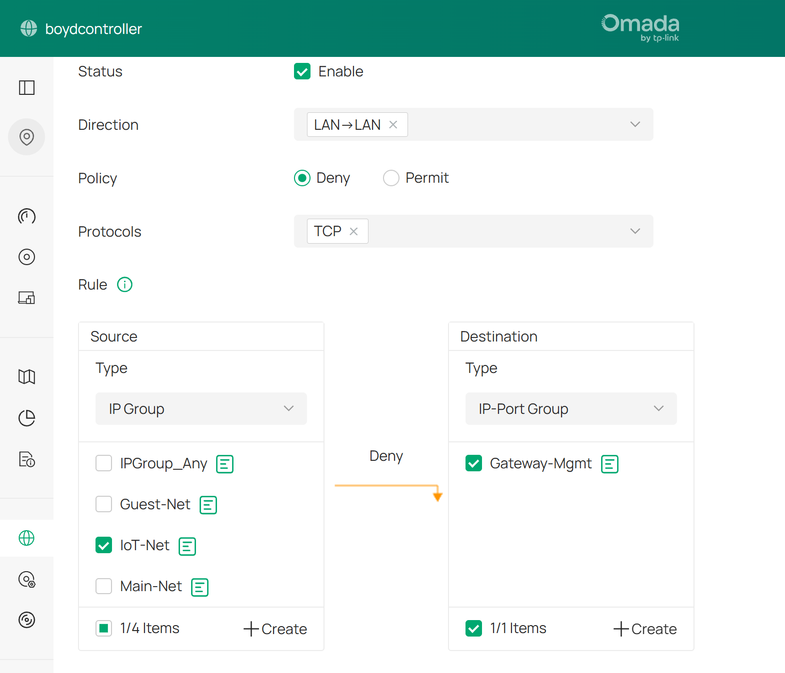

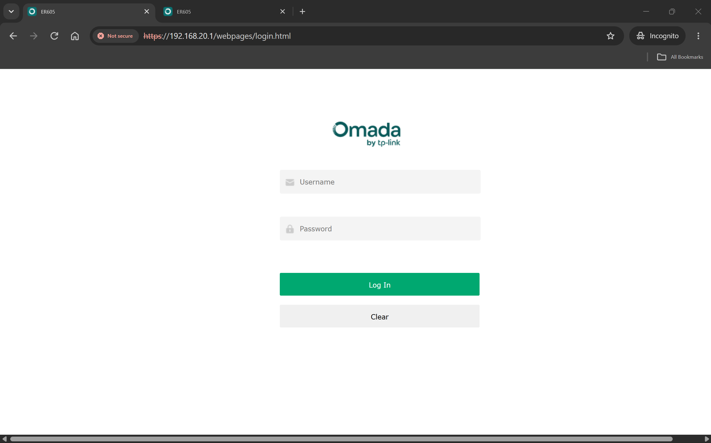

*With this rule active and the laptop confirmed on IoT (`192.168.20.116`), DNS and ping
worked — but the **login page still loaded** on both `.20.1` and `.0.1`.*

**Why:** the same lesson as the original finding. A normal LAN→LAN rule only sees traffic the
gateway *forwards*. Traffic addressed *to* the gateway never passes through it, so even an
exact-match IP and port rule is ignored. Only the special **Gateway Management Page**
destination hooks traffic to the gateway itself. This rule and its group were deleted.

### Attempt 3 — "Gateway Management Page", TCP only ✅

The admin page uses **TCP**; what Attempt 1 broke was DNS (mostly **UDP**) and ping
(**ICMP**). So: keep the special destination, restrict it to TCP.

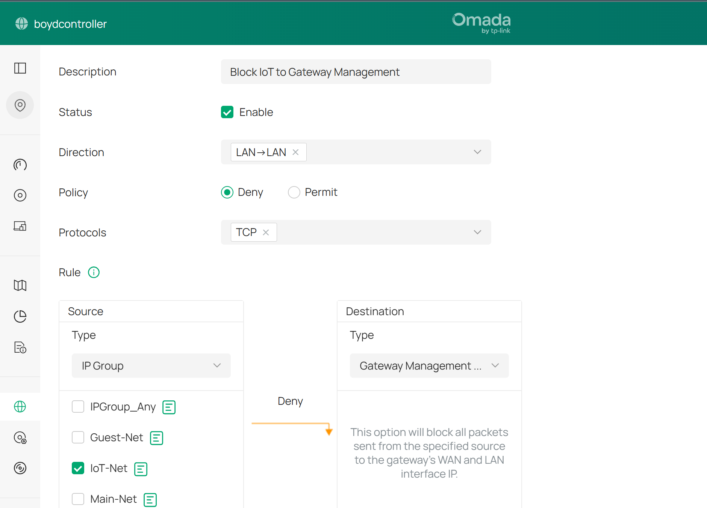

*Final Rule 5 — `Block IoT to Gateway Management`: LAN→LAN, Deny, **TCP only**, `IoT-Net` →
Gateway Management Page.*

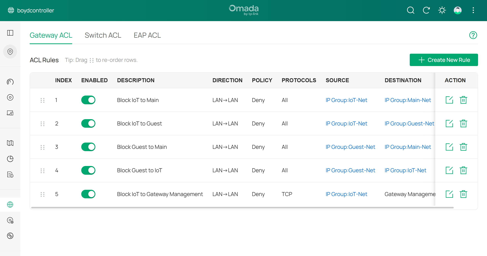

*The final rule set: four inter-VLAN denies (all protocols) plus Rule 5, scoped to TCP. The
Attempt 2 rule and its IP-Port Group are gone.*

### Re-test — both directions

**Legitimate traffic still works** (the regression check Attempt 1 skipped):

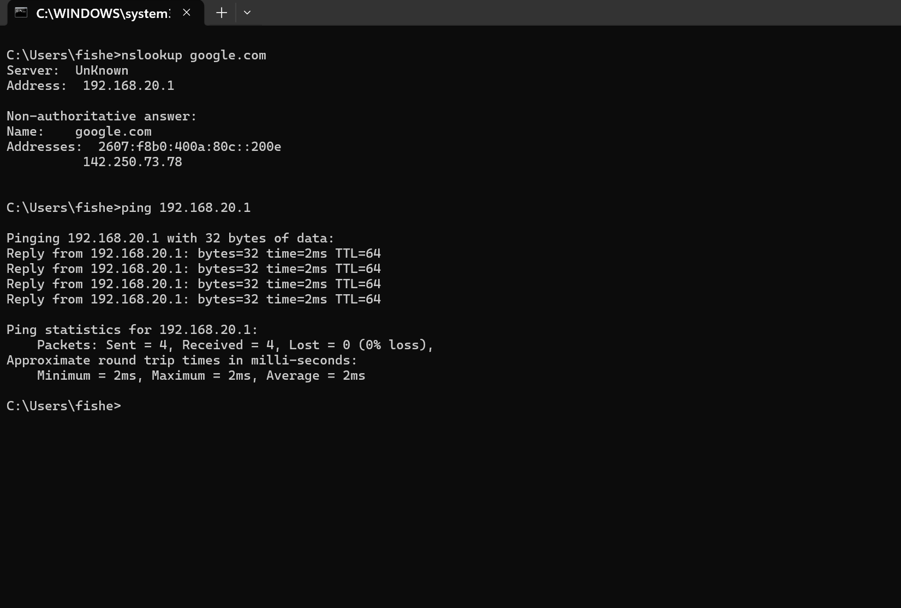

*DNS answered by `192.168.20.1`; gateway ping replies. The Bambu printer stays connected and
accepts print jobs.*

**The admin page is still blocked:**

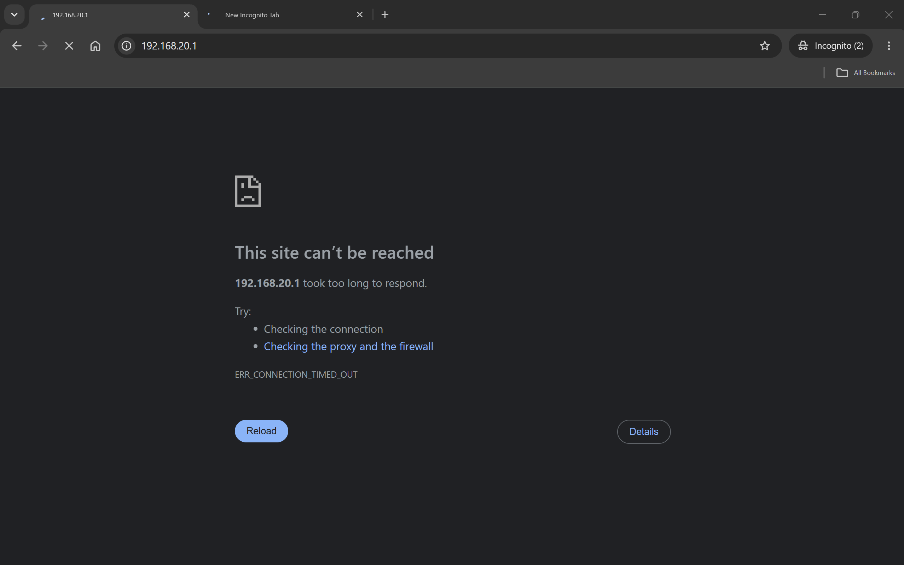

*`https://192.168.20.1` — IoT's own gateway address — times out, as does `https://192.168.0.1`.*

**Status: ✅ fixed.**

**Known trade-off:** the rule blocks *all* TCP to the gateway from IoT, not only ports
80/443. DNS normally uses UDP but can fall back to TCP for very large responses; those rare
lookups would fail from IoT. Accepted — no IoT device has shown a problem, and the alternative
(Attempt 2) doesn't block anything.

### Lessons

- **Pinging a gateway address is a misleading isolation test.** Test against a real host on
  the far side, with a baseline from the trusted side.
- **Inter-VLAN rules don't protect the router itself.** Traffic *to* the gateway needs its own
  controls, separate from traffic *through* it — and in Omada, only the dedicated
  Gateway Management Page destination reaches it.
- **Test that a security fix doesn't break legitimate traffic, not just that it blocks the bad
  traffic.** Attempt 1 passed every "blocked" test and still broke a real device.
- **Confirm which network you're testing from.** One round of tests here was accidentally run
  from Main; checking the DNS server in `nslookup` output (`192.168.0.1` vs `192.168.20.1`)
  caught it before it became a false conclusion.

---

## Concepts reinforced

- **VLAN segmentation** — separate broadcast domains / subnets on shared physical
  infrastructure via 802.1Q tagging
- **ACL evaluation** — top-down first match; implicit allow (Omada gateway) vs. implicit deny
  (Cisco)
- **Routed vs. to-the-device traffic** — LAN→LAN rules filter traffic *through* the gateway,
  not traffic addressed *to* it; management-plane access needs its own rule
- **TTL as a clue** — a reply at TTL=64 came straight from the device, not across a router hop
- **Testing method** — every "blocked" result needs a baseline proving the target responds,
  and every fix needs a regression check proving normal traffic still flows
- **Protocol-level scoping** — DNS (UDP), ping (ICMP) and web admin (TCP) can be separated by
  protocol even when they share a destination
- **Stateful firewalling** — return traffic for established sessions is auto-permitted,
  enabling one-way trust with deny rules alone
- **Service discovery protocols** — mDNS/Bonjour vs. SSDP/DIAL, and why multicast discovery
  needs a repeater to cross VLANs

---

**Previous:** [Phase 4 — mDNS & discovery](04-mdns-and-discovery.md) · **Back to:** [README](../README.md)
